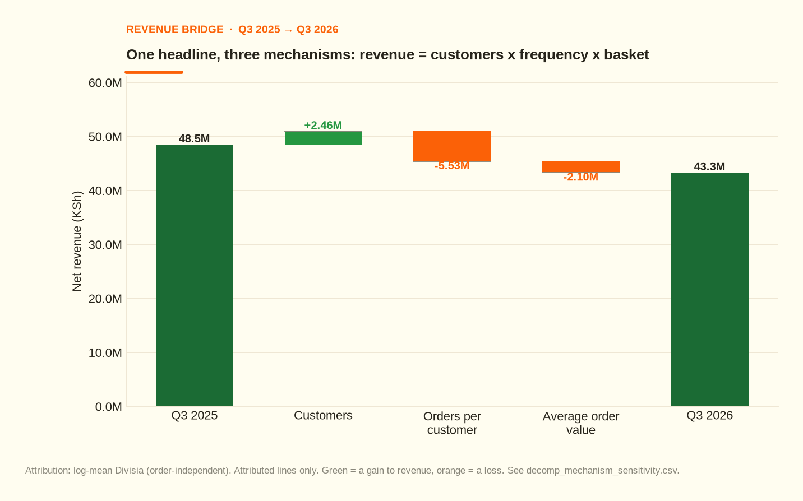
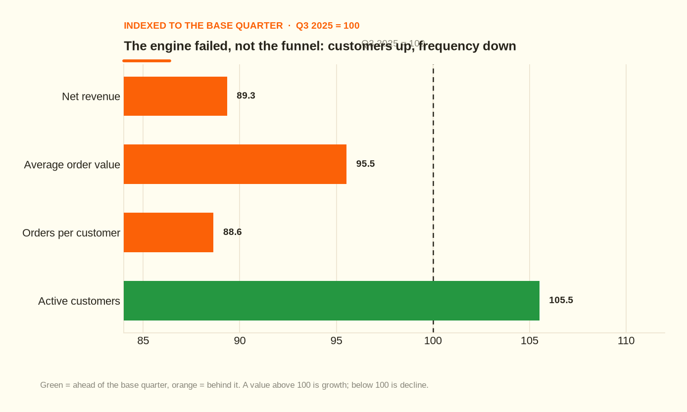
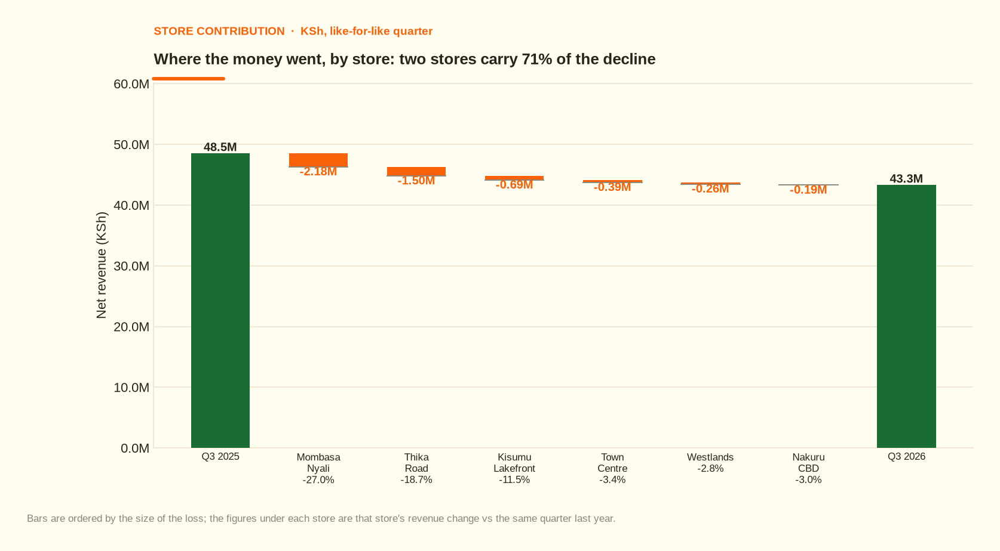
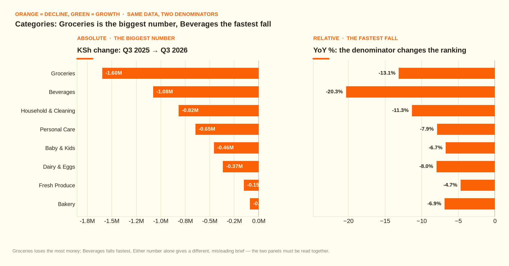
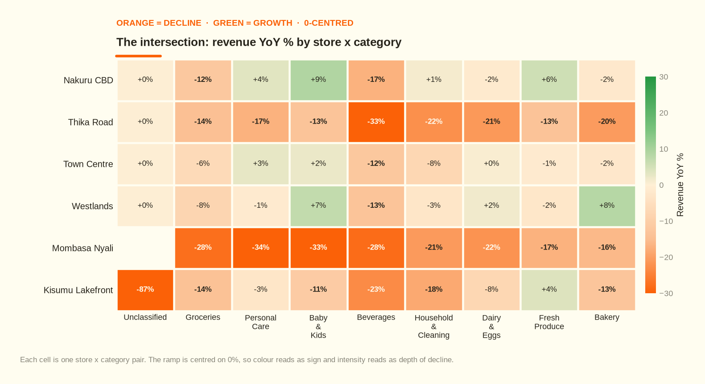
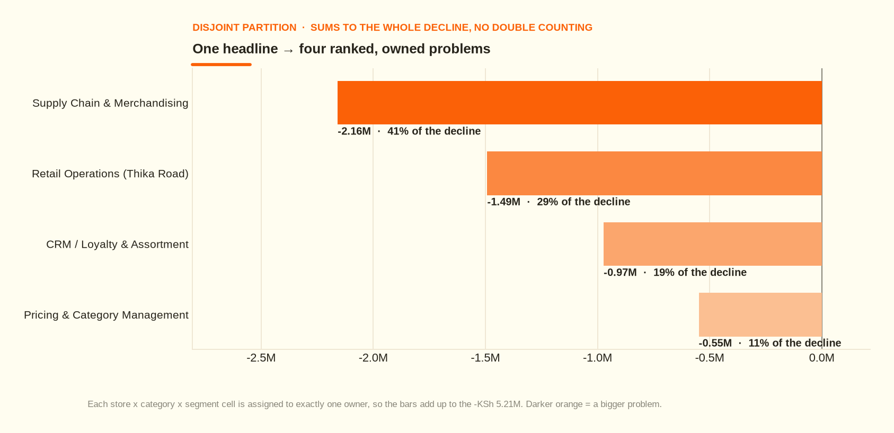
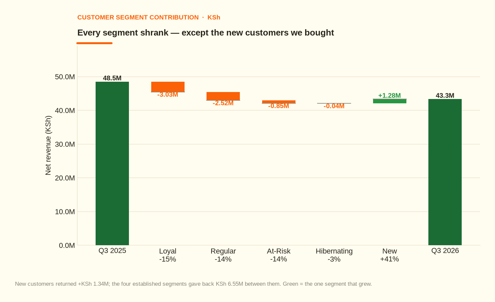
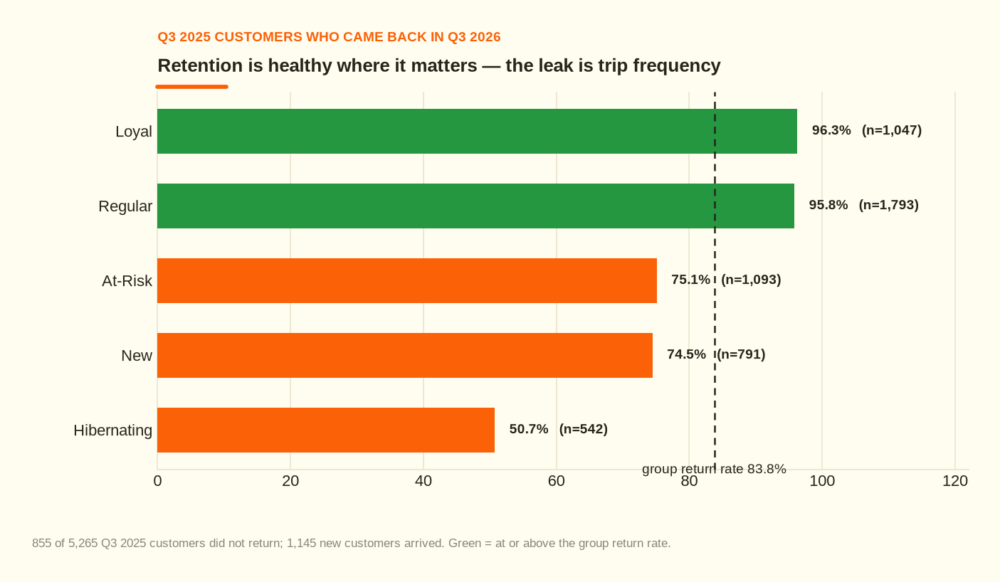
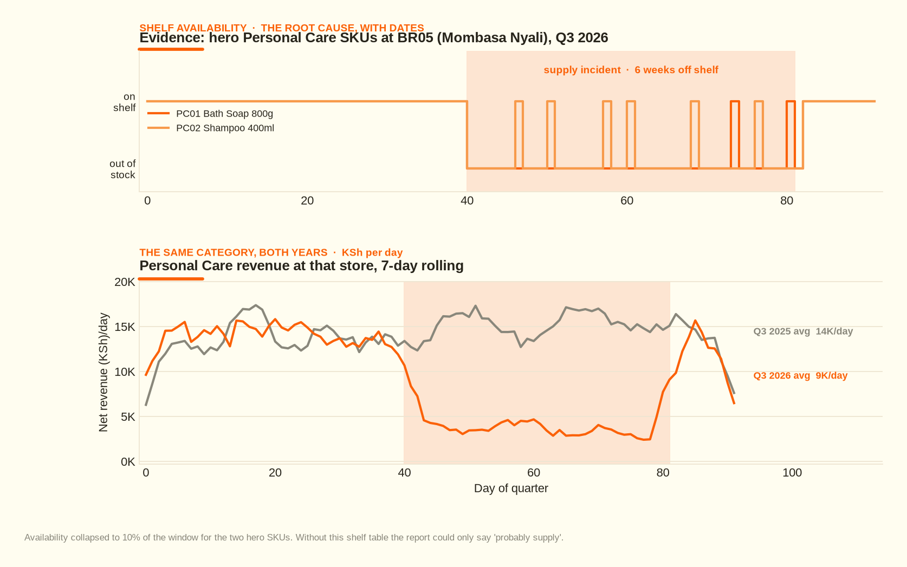
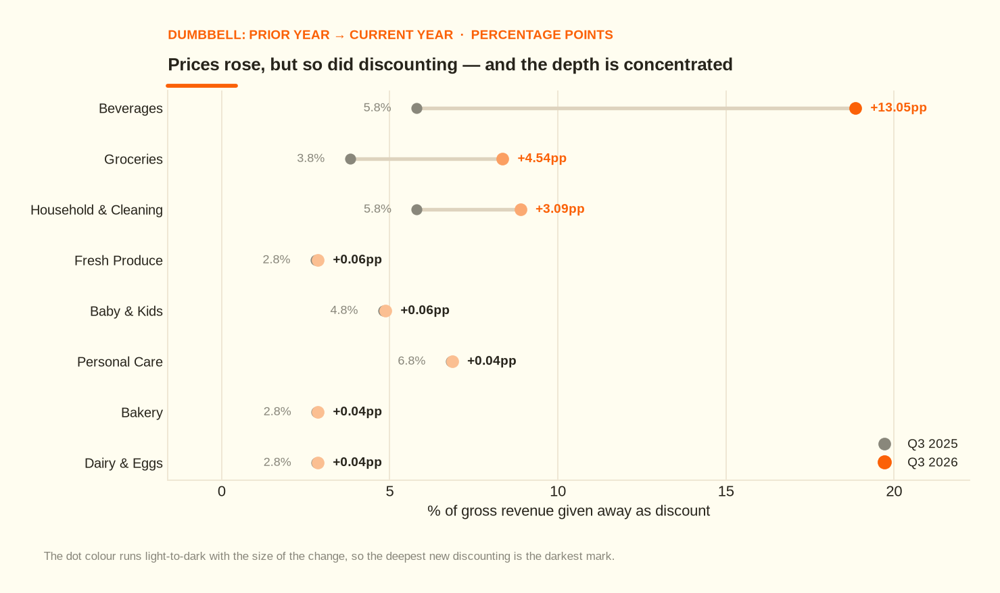

# Mavuno Home & Care — Why Revenue Fell 10%

**Patrick Gichuki** — Business Intelligence & Data Analyst  
[gichuki.site](https://gichuki.site) · [LinkedIn](https://www.linkedin.com/in/patrick-gichuki-the-bi-analyst) · [patrickgichuki2@gmail.com](mailto:patrickgichuki2@gmail.com)

> **A worked case study, not a chart pack.** A retailer lost 10.7% of its revenue.
> I found where the money went, why it went, and who owns each fix — then graded
> my own diagnosis against a sealed answer key (**14/14 checks pass**). Everything
> below reproduces from a single command.

**The one-line answer:** we did not lose customers — we lost trips and basket
size, and **two of six stores carry 71% of the decline**.

| | |
|---|---|
| **The question** | Which **branch × product × customer segment** drove the decline, and what did each contributor cost? |
| **The decision it feeds** | Whose plan gets rewritten next quarter — retention, pricing, or merchandising? |
| **The answer** | −10.7% revenue, −16.9% gross profit; two of six stores = 71%; four ranked problems, each with an owner, an expected gross-profit recovery and a review date |
| **Stack** | **SQL** — 9 scripts, 696 lines: star schema, views, CTEs, joins, window functions, data-quality checks · **Python** — numpy, matplotlib, python-docx, python-pptx, sqlite3 · **Power BI** — semantic model, DAX measures, RLS and page-by-page build ([spec](docs/07_dashboard_spec.md)) |
| **Scale** | 195,224 line items · 55,431 invoices · 6,412 customers · 39 SKUs · 6 stores · 2 like-for-like quarters |
| **Data** | **Simulated** from a documented mechanism, so the diagnosis can be *graded* rather than merely asserted — [why that matters](#about-the-data) |



*The 10% headline is three mechanisms, not one.*

## What this project is meant to demonstrate

It is the piece of work I would point at first, because it shows four things a BI
role actually asks for — roughly in order of how hard they are to fake:

1. **A governing question, not a data dump.** The analysis exists to answer one
   decision, and every table below is subordinate to it.
2. **Decomposition, not description.** Revenue is split into customers × frequency
   × basket size, then by store, category, segment and channel, then to the
   intersection where the damage actually sits.
3. **Rigour with declared limits.** Facts, hypotheses and unexplained findings are
   separated; the why-chain stops where the data stops instead of guessing.
4. **A deliverable a business can act on.** Four formats from one content model,
   every action carrying an owner, an expected recovery in **gross profit**, and a
   review date.

The underlying project on a simulated six-store Kenyan retailer: raw POS extract
→ cleaned star schema in SQL → mechanism/structure/intersection decomposition →
evidential 5-Whys → ranked, owned recommendations → validated against a known
ground truth.

**In this report:** [The decision](#1-the-decision-this-supports) ·
[Headline result](#2-what-happened--the-headline) ·
[Why it happened](#3-why-it-happened--the-mechanism) ·
[Where it happened](#4-where-it-happened--store-and-category) ·
[The intersection](#5-the-intersection--the-worst-cells) ·
[Who owns what](#6-who-owns-what--four-ranked-problems) ·
[Segments](#7-segments-cohorts-and-retention) ·
[The supply event](#8-the-supply-event-has-a-date) ·
[Pricing](#9-prices-rose-while-discounting-deepened) ·
[Facts vs hypotheses](#10-facts-hypotheses-and-the-edge-of-what-we-know) ·
[What to do](#11-what-to-do--the-action-register) ·
[Reproduce it](#12-reproduce-it)

> Full detail — every table, the sensitivity bands and the appendix — is in
> [`docs/04_findings_report.md`](docs/04_findings_report.md). This page is the
> readable version of the same analysis; the two are generated from the same
> numbers, so they cannot disagree.

---

## 1. The decision this supports

> **Whose plan gets rewritten next quarter — retention, pricing, or merchandising?**

The analysis is only worth reading to the extent it answers that. It does, in
[section 11](#11-what-to-do--the-action-register), with a number and an owner
attached to each answer.

## 2. What happened — the headline

**Group net revenue fell KSh 5.21M (10.7%) to KSh 43.65M, and gross profit fell
KSh 1.63M — worse than the revenue headline, because gross margin compressed
1.38pp to 18.57%.**

| Metric | Q3 2025 | Q3 2026 | Change |
|---|---:|---:|---:|
| Net revenue | KSh 48.86M | KSh 43.65M | **−10.7%** |
| Gross profit | KSh 9.68M | KSh 8.04M | **−16.9%** |
| Gross margin | 19.95% | 18.57% | −1.38pp |
| Active customers | 5,265 | 5,555 | **+5.5%** |
| Orders | 28,618 | 26,764 | −6.5% |
| Orders per customer | 5.44 | 4.82 | **−11.4%** |
| Average order value | KSh 1,694 | KSh 1,619 | **−4.5%** |
| Lines per order | 3.59 | 3.40 | −5.2% |
| List price per unit | KSh 312 | KSh 326 | **+4.3%** |

Revenue is not profit: gross profit fell 16.9% against a 10.7% revenue fall.
Every recommendation below is therefore priced in **gross profit**, not just
revenue.

## 3. Why it happened — the mechanism

`Revenue = Customers × Frequency × Average order value`

| Driver | Effect on revenue | YoY move |
|---|---:|---:|
| Customers | KSh 2.46M | +5.5% |
| Orders per customer | KSh −5.53M | −11.4% |
| Average order value | KSh −2.10M | −4.5% |
| **Total** | **KSh −5.21M** | **−10.7%** |

Attribution is **log-mean Divisia**, so the ranking does not depend on the order
you multiply in. The sequential-order sensitivity band is: customers KSh 2.26M
to KSh 2.67M; frequency KSh −5.81M to KSh −5.26M; AOV KSh −2.17M to KSh −2.03M.
The frequency effect is the largest under every ordering — that is the robust
part of the result.



*Customers up, frequency down — the engine failed, not the funnel.*

The critical read: **customers grew +5.5%, so any report that stops at "fewer
customers" is wrong.** Acquisition is working. What failed is repeat behaviour.

## 4. Where it happened — store and category

### By store

| Rank | Slice | Revenue change | YoY | Share of group decline |
|---:|---|---:|---:|---:|
| 1 | Mombasa Nyali | KSh −2.18M | −27.0% | 41.9% |
| 2 | Thika Road | KSh −1.50M | −18.7% | 28.9% |
| 3 | Kisumu Lakefront | KSh −0.69M | −11.5% | 13.2% |
| 4 | Town Centre | KSh −0.39M | −3.4% | 7.4% |
| 5 | Westlands | KSh −0.26M | −2.8% | 5.0% |
| 6 | Nakuru CBD | KSh −0.19M | −3.0% | 3.6% |



*Two stores carry 71% of the decline.*

Mombasa Nyali and Thika Road are not a chain-wide problem; they are two local
events.

### By category

| Rank | Slice | Revenue change | YoY | Share of group decline |
|---:|---|---:|---:|---:|
| 1 | Groceries | KSh −1.60M | −13.1% | 30.7% |
| 2 | Beverages | KSh −1.08M | −20.3% | 20.7% |
| 3 | Household & Cleaning | KSh −0.82M | −11.3% | 15.7% |
| 4 | Personal Care | KSh −0.65M | −7.9% | 12.4% |
| 5 | Baby & Kids | KSh −0.46M | −6.7% | 8.8% |
| 6 | Dairy & Eggs | KSh −0.37M | −8.0% | 7.0% |
| 7 | Fresh Produce | KSh −0.15M | −4.7% | 2.9% |
| 8 | Bakery | KSh −0.09M | −6.9% | 1.7% |
| 9 | Unclassified | KSh −0.00M | −27.9% | 0.0% |



*Groceries is the biggest KSh loss, Beverages the fastest fall — both true, each alone misleading.*

Note how the two panels of the category chart disagree: Groceries is the largest
**absolute** loss, Beverages the largest **percentage** loss. Both are true;
either alone is a misleading brief.

## 5. The intersection — the worst cells



*The decline is concentrated in the intersection, not diffuse.*

The decline is concentrated, not diffuse: the worst 8 cells (store × category ×
segment) account for **23.5% of the total**.

| # | Cell | Revenue change | YoY | % of group decline |
|---:|---|---:|---:|---:|
| 1 | Mombasa Nyali · Groceries · Regular | KSh −0.28M | −33.6% | 5.4% |
| 2 | Mombasa Nyali · Groceries · Loyal | KSh −0.23M | −29.6% | 4.4% |
| 3 | Mombasa Nyali · Personal Care · Regular | KSh −0.22M | −41.1% | 4.2% |
| 4 | Mombasa Nyali · Baby & Kids · Loyal | KSh −0.21M | −42.0% | 4.0% |
| 5 | Mombasa Nyali · Personal Care · Loyal | KSh −0.19M | −35.9% | 3.6% |
| 6 | Mombasa Nyali · Baby & Kids · Regular | KSh −0.17M | −34.8% | 3.3% |
| 7 | Thika Road · Personal Care · Loyal | KSh −0.17M | −30.9% | 3.3% |
| 8 | Mombasa Nyali · Household & Cleaning · Regular | KSh −0.17M | −37.0% | 3.2% |

**The counter-intuitive result:** the single largest cell is not Personal Care —
it is Mombasa Nyali | Groceries | Regular. At Mombasa Nyali, every category fell
25–40% because the stock failure removed the reason for the trip and the whole
basket shrank with it. If you had only measured the affected category, you would
have understated this event by roughly **4.8×**.

## 6. Who owns what — four ranked problems



*Four ranked, owned problems, summing to the whole decline.*

Each store × category × segment cell is assigned to **exactly one** owner, so
these bars add up to the whole decline with no double counting.

| Rank | Owner | Problem | Cost | Share |
|---:|---|---|---:|---:|
| 1 | Supply Chain & Merchandising | Two hero Personal Care SKUs out of stock for six weeks at Mombasa Nyali; the damage spread to whole baskets | KSh −2.16M | 41.4% |
| 2 | Retail Operations (Thika Road) | Thika Road footfall cut for the full quarter — visits per customer well below every other store | KSh −1.49M | 28.6% |
| 3 | CRM / Loyalty & Assortment | Residual: fewer trips per customer and slimmer baskets right across the chain | KSh −0.97M | 18.7% |
| 4 | Pricing & Category Management | Beverage promotional depth deepened sharply outside the two affected stores | KSh −0.55M | 10.5% |
| — | Data / POS capture | Reconciliation: revenue with no customer identifier (anonymous walk-ins) | KSh −0.04M | 0.7% |

### The signatures are different, so the fixes must be too

| | Customers | Frequency | Basket value | Diagnosis |
|---|---:|---:|---:|---|
| Mombasa Nyali | +7.0% | −11.7% | −22.6% | lost trips **and** basket |
| Thika Road | +6.9% | −23.7% | −0.3% | lost trips only |
| Group | +5.5% | −11.4% | −4.5% | frequency-led |

That table is the single most useful thing in this report. A **basket** problem
needs merchandising; a **traffic** problem needs access, hours and local
marketing. Applying one fix to both stores would waste a quarter.

## 7. Segments, cohorts and retention



*Every established segment shrank; only bought growth grew.*

| Rank | Slice | Revenue change | YoY | Share of group decline |
|---:|---|---:|---:|---:|
| 1 | Loyal | KSh −3.03M | −15.2% | 58.2% |
| 2 | Regular | KSh −2.52M | −14.0% | 48.4% |
| 3 | At-Risk | KSh −0.85M | −14.2% | 16.3% |
| 4 | Hibernating | KSh −0.04M | −2.9% | 0.8% |
| 5 | New | KSh **+1.28M** | **+40.7%** | −24.5% |

Every established segment shrank; the only growth came from 1,145 new customers
worth KSh 1.28M. Buying growth is not a strategy while the existing base is
contracting.



*Retention is healthy — the leak is trip frequency.*

855 customers who shopped in Q3 2025 did not return, but **83.8% did return**, so
churn is not the problem. The loss is in how often the returning base came back.

## 8. The supply event has a date



*The supply failure has a date, a store and a revenue trace.*

Two hero Personal Care SKUs sat off the shelf for six weeks at Mombasa Nyali:
**76 out-of-stock days out of 84 observations (9.5% shelf availability), first
gap 2026-08-10**, longest consecutive outage 33 days on the worst SKU.

Personal Care revenue at that store fell −34.2% — but Mombasa's average order
value also fell −22.6% (KSh 1,724 → KSh 1,334) against a group AOV change of
−4.5%. **The missing items cost the whole basket, not just the category.**

The availability panel is the whole reason this report can say "supply failure"
instead of "probably supply". Without the shelf-availability table, 9.5%
availability for 76 days would be a guess.

## 9. Prices rose while discounting deepened



*Prices rose while discounting deepened.*

List prices rose **+4.3%** yet average order value still fell: discount depth went
from 4.80% to 7.82% of gross, giving away roughly an extra **KSh 1.43M** in the
quarter. Discounting, not pricing, is the second lever.

## 10. Facts, hypotheses, and the edge of what we know

| Statement | Tier |
|---|---|
| Revenue fell 10.7%; gross profit fell 16.9% | **Fact** (measured) |
| Two stores explain 71% of the decline | **Fact** (measured) |
| Hero SKUs were 9.5% available for 76 days at Mombasa Nyali | **Fact** (measured) |
| The stock-out *caused* the basket erosion at that store | **Hypothesis — consistent with**, not proven: the two co-move exactly in time, but no causal test was run |
| Single-sourcing / no safety stock caused the stock-out | **Hypothesis** — no procurement or lead-time data in this extract |
| Thika Road's decline is due to the road-works | **Hypothesis** — the frequency-only signature is consistent with an access problem, and no other local factor is recorded |
| Kisumu Lakefront's −11.5% | **Unexplained.** Flagged, not back-filled with a story |
| 855 customers who shopped in Q3 2025 did not return | **Fact**, but 83.8% did return — churn is not the problem |

**Declared limits** (limits on the *conclusions*, not footnotes):

- **0.76% of revenue has no customer identifier** (KSh 0.70M of anonymous
  walk-ins). Segment-level conclusions therefore reconcile to 99.24%, not 100%;
  the reconciliation appears as its own line above rather than being hidden in
  an "Other" bucket.
- **No procurement, lead-time or supplier data exists in this extract**, so the
  why-chain stops instead of speculating.
- **The dataset is simulated** from a documented mechanism, which is what lets
  the analysis be graded (see [`outputs/validation_report.md`](outputs/validation_report.md)
  — 14/14 checks passed).

### Predictive — the run-rate if nothing changes

If Q3's frequency and basket levels persist, the annualised revenue impact is
roughly **KSh −20.83M** (KSh −5.21M × 4). That is a **run-rate, not a forecast**:
it assumes the Mombasa incident does not repeat (it should be fixed) and ignores
Q4 seasonality, which is typically stronger. Treat it as the size of the hole,
not the shape of the year.

## 11. What to do — the action register

Full register with owners, expected impact and review dates:
[`docs/06_recommendations.md`](docs/06_recommendations.md).

| # | Action | Owner | Expected gross-profit recovery | Review |
|---:|---|---|---:|---|
| 1 | Restore stock and dual-source the two hero SKUs | Supply Chain | KSh 0.28M – KSh 0.40M | +30 days |
| 2 | Rebuild the Mombasa basket (substitutes, adjacency, staff script) | Merchandising | KSh 0.03M | +45 days |
| 3 | Thika Road access recovery plan with the landlord and county | Retail Operations | KSh 0.17M | +60 days |
| 4 | Cap beverage discount depth back toward 4.8% | Pricing | KSh 0.27M | +21 days |
| 5 | Convert the frequency leak: win-back + second-purchase nudge | CRM / Loyalty | KSh 0.09M | +90 days |
| 6 | Capture a customer ID on every transaction; start logging supplier lead times | Data / POS | enables the next diagnosis | next quarter |
| | **Total expected gross-profit recovery** | | **KSh 0.85M – KSh 0.97M** | vs a KSh 1.63M gross-profit decline |

**Impacts are gross-profit recovery, not revenue recovered.** Volume, traffic and
basket actions are converted at the blended Q3 2026 gross margin (18.57%); the
pricing action is a discount stop, so clawing it back converts at near-full value
rather than at margin. Together the register recovers **52–59% of the gross profit
the quarter lost** — deliberately short of the whole hole, because no plan
recovers all of it in one quarter. The pipeline asserts this cannot exceed the
loss, so the register can never again promise more than was lost.

> **These are simulated outcomes, not measured business results.** The recovery
> figures illustrate the sizing method on a synthetic dataset; they are not
> evidence that any of this happened in a real company.

Each action has an owner, an expected impact and a review date. The follow-up
question that closes the loop: **did any of it change a decision?**

## 12. Reproduce it

No installation. The repo vendors numpy / matplotlib / python-docx / python-pptx
under `pylibs/`, and the scripts add it to `sys.path` automatically.

**Interpreter pin.** The vendored numpy is built for **CPython 3.12**, so a newer
`python3` cannot import it. Run the pipeline with a 3.12 interpreter that can see
`pylibs/`, or let the Makefile find one:

```bash
make                                 # everything (~60s), auto-detects a 3.12 interpreter
make PY=/usr/bin/python3.12          # or name one explicitly
```

Directly:

```bash
python3.12 src/run_pipeline.py          # everything
python3.12 src/run_pipeline.py --fast   # skip regeneration, re-run analysis only
```

Individual steps:

```bash
python3.12 src/generate_data.py           # simulate the dataset (~9s)
python3.12 src/clean_data.py              # audit + fix, write the quality report
python3.12 src/run_sql.py                 # build SQLite, run every sql/*.sql
python3.12 src/decompose.py               # mechanism → structure → intersect
python3.12 src/five_whys.py               # the evidential why-chain
python3.12 src/write_report.py            # findings + recommendations
python3.12 src/make_figures.py            # the 10 figures, in the dashboard's style
python3.12 src/write_reports.py           # brief + deck + Word + PDF
python3.12 src/validate_against_truth.py  # exit 0 = 14/14 checks pass
```

> The PDFs are produced from the Word files with headless LibreOffice, so the
> Word and PDF versions cannot disagree about a number or a page.

Inspect the warehouse directly (SQLite is stdlib, so no client is needed):

```bash
python3 -c "import sqlite3; print(sqlite3.connect('data/revenue_decline.sqlite')
            .execute('SELECT * FROM mechanism_by_period').fetchall())"
```

### Why you can trust these numbers

| Property | How it is enforced |
|---|---|
| Every number is reproducible | `python3 src/run_pipeline.py` regenerates data → warehouse → analysis → documents → figures |
| The prose cannot drift from the data | this README, the findings report and the recommendations are generated from `outputs/kpis.json` |
| The attribution is not order-dependent | log-mean Divisia, with a sequential sensitivity band reported alongside |
| The ownership table cannot silently break | `decompose.py` hard-fails if the driver partition doesn't cover the decline exactly |
| The analysis is graded, not just presented | `src/validate_against_truth.py` asserts 14 falsifiable claims — **14/14 pass** |
| Data quality is proven, not assumed | 9 planted defect classes, all detected; grain and referential-integrity checks return 0 failures |
| The unanswerable is declared | the 5th why (why the stock ran out) stops at a data-capture recommendation instead of a guess |

### Reports

Four formats, one source. Every number in all four comes from
`outputs/kpis.json` and the exported tables via
[`src/report_content.py`](src/report_content.py).

| Artefact | Audience | Why this format |
|---|---|---|
| [Executive brief](outputs/reports/Executive_Brief.pdf) (2 pp) | the CEO | the only page that gets read before the meeting |
| [Deck](outputs/reports/Revenue_Decline_Diagnostic.pptx) (17 slides) | the boardroom | presented, not read; notes on every slide |
| [Word report](outputs/reports/Revenue_Decline_Diagnostic.docx) (21 pp) | the team | the working document — editable |
| [PDF report](outputs/reports/Revenue_Decline_Diagnostic.pdf) (21 pp) | circulation | the locked, distributable version of the Word report |

## How this was built, and what was mine

The pipeline is real — `make` regenerates the dataset, the warehouse, the
analysis, the prose, the ten figures and all four documents, so the documents
cannot drift from the data. That is an **engineering** claim, and it is worth
keeping separate from the **analytical** claim:

**The judgment calls are mine; the code executes them.** Specifically:

- Choosing the **grain** (line item, not invoice) and insisting that "orders" be
  `DISTINCTCOUNT(invoice_id)` rather than a row count.
- Choosing **log-mean Divisia** over a sequential decomposition, then reporting
  the sequential band beside it so a reader can see the attribution is not an
  artefact of the order the factors are multiplied in.
- Choosing the **one-owner partition rule** — every store × category × segment
  cell assigned to exactly one department — so the ranked problems sum to the
  decline with no double counting.
- Deciding that **impacts are stated in gross profit** and converted at margin,
  which is what stops the register promising more than the quarter lost.
- Deciding **where to stop**: the fifth why is unanswerable in this extract, so
  the chain ends at a data-capture recommendation rather than a plausible story.
- Writing the **14 falsifiable checks** the diagnosis is graded against.

What the pipeline removes is transcription error and drift. It does not make the
six decisions above, and a reviewer is entitled to disagree with any of them.

## Repository layout

```
project-1-revenue-decline-diagnostic/
├── README.md                     ← you are here: the report
├── PROJECT_BRIEF.md              short pointer to the full brief
├── docs/
│   ├── 00_ground_truth.md        the sealed answer key (read after)
│   ├── 01_data_dictionary.md     grain, columns, denominators, segment rules
│   ├── 02_methodology.md         why each method, and its limits
│   ├── 03_data_quality_report.md GENERATED
│   ├── 04_findings_report.md     GENERATED — the full deliverable
│   ├── 05_five_whys.md           GENERATED — the evidential why-chain
│   ├── 06_recommendations.md     GENERATED — action register
│   ├── 07_dashboard_spec.md      Power BI build spec (measures, pages, RLS)
│   ├── 08_project_brief.md       question, decision, scope, success criteria
│   └── 09_executive_brief.md     GENERATED — the one-pager, in plain text
├── Dashboard/                    the four Power BI page images this pack matches
├── data/                         GENERATED — not committed (see .gitignore)
│   ├── raw/                      simulated POS export WITH planted defects
│   ├── processed/                cleaned star schema (what analysis uses)
│   └── revenue_decline.sqlite    the warehouse
├── sql/                          01 schema · 02 views · 03 quality · 04 mechanism
│                                 · 05 structure · 06 cohort · 07 crosscut
│                                 · 08 stockout · 09 pricing
├── src/                          config · generate_data · clean_data · run_sql
│                                 · decompose · five_whys · write_report
│                                 · theme (the shared visual language)
│                                 · make_figures · report_content · docx_kit
│                                 · write_reports · validate_against_truth
│                                 · run_pipeline (entry point)
└── outputs/
    ├── figures/                  10 charts, embedded above
    ├── reports/                  the executive brief, the deck, the Word report, the PDF
    ├── tables/                   every table cited anywhere in the docs
    ├── kpis.json                 machine-readable headline metrics
    └── validation_report.md      the analysis graded against the truth
```

## About the data

The dataset is **simulated** from a documented mechanism (`src/config.py` →
`STORY`, `MIGRATION`; written out in `docs/00_ground_truth.md`). That is a
deliberate design choice, not a shortcut: it is what allows the diagnosis to be
**graded** rather than merely presented. The simulation also plants nine classes
of real-world data-quality defect so the cleaning step has genuine work to do.

Line-item grain: **one row = one line item on one customer receipt** — 195,224
lines across 55,431 invoices in the two quarters, plus a separate branch × SKU ×
day shelf-availability table that makes the supply event provable.

~195k line items · 55,431 invoices · 6,412 customers · 39 SKUs · 8 categories ·
6 stores · 2 quarters. Seed **20260914**; the figures quoted here reflect that
seed, while everything in `docs/04`–`06` recomputes itself.

`data/` is **not committed** — it is ~110 MB and is regenerated in full by
`make`, so a fresh clone rebuilds it on the first run.

## Suggested reading order

1. [The project brief](docs/08_project_brief.md) — what was asked and why
2. [The findings report](docs/04_findings_report.md) — the answer, in full
3. [The five whys](docs/05_five_whys.md) — the evidence chain behind it
4. [The recommendations](docs/06_recommendations.md) — what to do on Monday
5. [The methodology](docs/02_methodology.md) — how to challenge the numbers
6. [`src/decompose.py`](src/decompose.py) — the attribution maths itself
7. [The ground truth](docs/00_ground_truth.md) — what was really baked in
